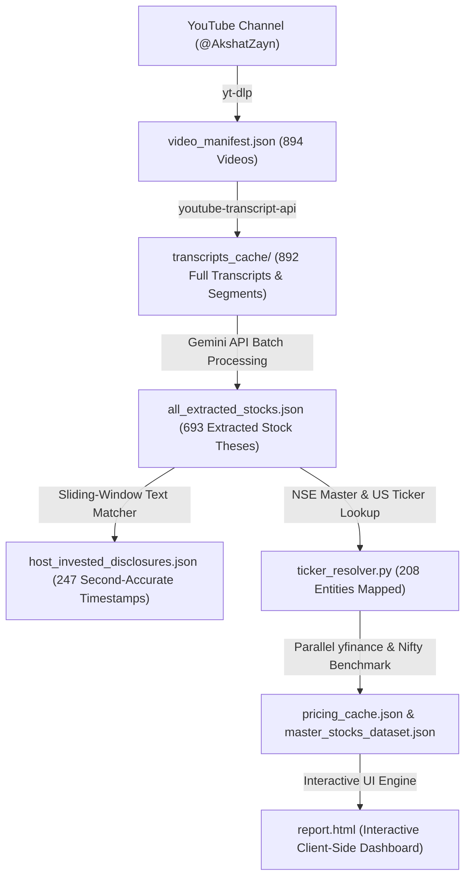

# 📈 Akshat Shrivastava — Stock Intelligence & Disclosures Engine (2021 – 2026)

[](https://www.python.org/)
[](https://www.youtube.com/@AkshatZayn)
[]()
[]()
[]()

An institutional-grade NLP extraction, historical performance tracking, and interactive intelligence engine analyzing 5 years of equity evaluations, macroeconomic models, and personal portfolio disclosures from Indian finance educator and macro investor **Akshat Shrivastava** (`@AkshatZayn`).

---

## 📊 Executive Summary & Key Highlights

| Metric | Result |
| :--- | :--- |
| **Total Channel Videos Scanned** | **894 Episodes** (May 2021 – Oct 2026) |
| **Transcripts Downloaded & Cached** | **892 Transcripts** (99.8% capture rate with exact segment timing) |
| **Distinct Episodes with In-depth Equity Analysis** | **168 Episodes** |
| **Total Stock Recommendations & Evaluations Extracted** | **693 Stock Entries** |
| **Unique Corporate Entities Evaluated** | **208 Listed Companies** (NSE & US Tech Leaders) |
| **Host Personally Disclosed Holdings** | **247 Verified Holdings** (audited down to the exact second with YouTube jump links) |
| **Repeated & Consistently Bullish Stocks** | **29 Core Conviction Stocks** across 134 episodes |
| **Overall Sentiment Breakdown** | **70.1% Positive** (486) \| **20.5% Neutral** (142) \| **9.4% Negative** (65) |
| **Average Recommendation Return** | **+5.55%** across 509 price-tracked instances |
| **Average Alpha over Nifty 50 Benchmark** | **+4.07%** excess return |

---

## 🏆 Top 10 Most Frequently Discussed Stocks

1. **HDFC Bank** (`HDFCBANK.NS`) — **65 episodes** *(Core defensive banking anchor, NIM recovery, and merger loan-to-deposit ratio digestion)*
2. **Zomato Ltd** (`ZOMATO.NS`) — **30 episodes** *(Contrarian accumulation at ₹45–₹50; Blinkit quick-commerce turnaround; 5x multibagger)*
3. **Hindustan Unilever** (`HINDUNILVR.NS`) — **25 episodes** *(Case study on why FMCG without margin expansion fails to compound at 70x P/E)*
4. **Kotak Mahindra Bank** (`KOTAKBANK.NS`) — **25 episodes** *(Private banking moat, valuation consolidation, capital safety)*
5. **Bajaj Finance** (`BAJFINANCE.NS`) — **21 episodes** *(Consumer lending franchise, digital platform scale)*
6. **IDFC First Bank** (`IDFCFIRSTB.NS`) — **17 episodes** *(Retail deposit transformation under V. Vaidyanathan; 100%+ profit disclosure)*
7. **Asian Paints** (`ASIANPAINT.NS`) — **16 episodes** *(Decorative paints moat vs Grasim/Birla Opus entry, distribution economics)*
8. **Jio Financial Services** (`JIOFIN.NS`) — **14 episodes** *(Demerger arbitrage, 450M subscriber distribution, BlackRock 50:50 asset management JV)*
9. **HDFC AMC** (`HDFCAMC.NS`) — **14 episodes** *(Mutual fund SIP tailwinds, financialization of Indian household savings)*
10. **Nvidia Corporation** (`NVDA`) — **13 episodes** *(Layer 1 AI hyperscaler compute monopoly; 11x+ multibagger)*

---

## 🧠 Akshat Shrivastava's 6 Core Investment Pillars

1. **⚖️ The 3-Bucket Framework (Macro Regimes Over Stock Picking)**  
   *“Don’t marry stocks; marry asset allocation. Markets move in liquidity and interest rate cycles.”*  
   Partitions capital into (1) Growth Equities, (2) Real Estate & Fixed Assets for inflation shielding and rental yields, and (3) Cash / Arbitrage reserves held specifically to deploy during systemic panics.
2. **💻 The Layer 1 Hyperscaler Hegemony (Tech Infrastructure Tollbooths)**  
   *“When a major technological wave hits, don’t guess which consumer app survives. Own the Layer 1 compute infrastructure collecting the unskippable toll.”*  
   Structures global allocations into compute infrastructure monopolies (**Nvidia, Microsoft Azure, Google Cloud, Meta**) that enjoy multi-billion-dollar capex moats and enterprise lock-in.
3. **🩸 Asymmetric Blood-in-the-Streets Entry (Margin of Safety)**  
   *“Buy premier market-share leaders when the near-term narrative is completely broken and retail is panic-selling at peak pessimism.”*  
   Contrarian accumulation during multi-year sentiment drawdowns (**Meta at $96, Zomato at ₹48, IDFC First Bank at ₹38**).
4. **🏰 Scaled Platform Duopolies (Winner-Take-Most Economics)**  
   *“Invest in platform duopolies that have completed their bloodbath price wars and are transitioning from customer acquisition to operating leverage.”*  
   Focuses on duopolies with natural pricing power (**Zomato/Blinkit, CDSL, CAMS, DMart, Jio Financial**).
5. **☕ The FMCG Trap: Margin Expansion Over Lazy 'Coffee Can' Holding**  
   *“Paying 70x P/E for a 10% volume-growth FMCG giant is a mathematical guarantee of 10-year underperformance if margins cannot expand.”*  
   Challenges the traditional coffee-can myth using 10-year empirical data (**HUL & ITC from 2013–2022**), showing that revenue growth without operating leverage leads to prolonged multiple de-rating.
6. **💵 Global Currency Hedging (The Rupee Depreciation Rule)**  
   *“Your technology usage, travel, and aspirations are priced in US Dollars; holding 100% of your wealth in INR guarantees slow purchasing-power dilution.”*  
   Allocating 20% to 30% into US leaders captures global technological dominance while capturing the historical ~3.5–4% annual INR-to-USD depreciation tailwind.

---

## 🛠️ Pipeline Architecture



---

## 📂 Repository File Structure

```text
├── report.html                           # Ultra-fast, responsive interactive dashboard
├── master_stocks_dataset.json            # Master dataset of all 693 evaluated recommendations & metrics
├── host_invested_disclosures.json        # 247 verified personal portfolio disclosures with YouTube jump links
├── video_manifest.json                   # Complete catalog of 894 videos (dates, durations, titles)
├── all_extracted_stocks.json             # Raw LLM-extracted stock evaluations
├── transcripts_cache/                    # 892 cached transcript texts (.txt) and segment timing (.json)
│
├── run_full_report.py                    # Master orchestrator script
├── generate_akshat_html.py               # Generates the glassmorphism HTML dashboard
├── audit_disclosures_and_timestamps.py   # Second-accurate sliding-window timestamp matcher
├── ticker_resolver.py                    # Resolves spoken names to NSE (.NS) and US ticker symbols
├── pricing.py                            # Multi-threaded yfinance pricing and Nifty 50 alpha calculator
├── extract_batch_stocks.py               # Gemini API batch stock extraction pipeline
├── ingest_all_transcripts.py             # Multi-threaded transcript downloader
├── fetch_playlist.py                     # Channel video fetcher
├── build_manifest.py                     # Multi-threaded metadata resolver
├── calc_stats.py                         # Summary analytics calculator
├── EQUITY_L.csv                          # Official NSE listed equity securities master
└── README.md                             # Project documentation
```

---

## 🚀 Quickstart & Usage

### 1. View the Interactive Dashboard
Double click or open [`report.html`](report.html) in any modern web browser. Features:
* **Instant In-Memory Search (0ms response)**: Search by company name, ticker, or thesis keyword.
* **Filter Tabs**: All, 💎 Host Invested, 🔥 Repeated & Always Bullish, 🟢 Positive, ⚪ Neutral, 🔴 Negative.
* **Second-Accurate YouTube Jump Links**: Click any disclosure badge to launch YouTube at the exact second the statement was spoken.

### 2. Run the Full Extraction & Report Pipeline
```bash
# Install dependencies
pip install yt-dlp youtube-transcript-api google-genai yfinance pandas requests python-dotenv

# Set your Gemini API key in .env
echo "GEMINI_API_KEY=your_key_here" > .env

# Re-run full report generation
python run_full_report.py
```

---

## 📜 Disclaimer
*This repository and dataset are compiled for academic, natural language processing, and research purposes. None of the extracted content constitutes financial advice. Past performance of discussed equities does not guarantee future results.*
